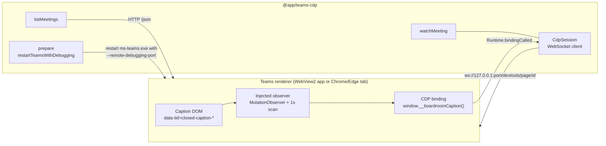
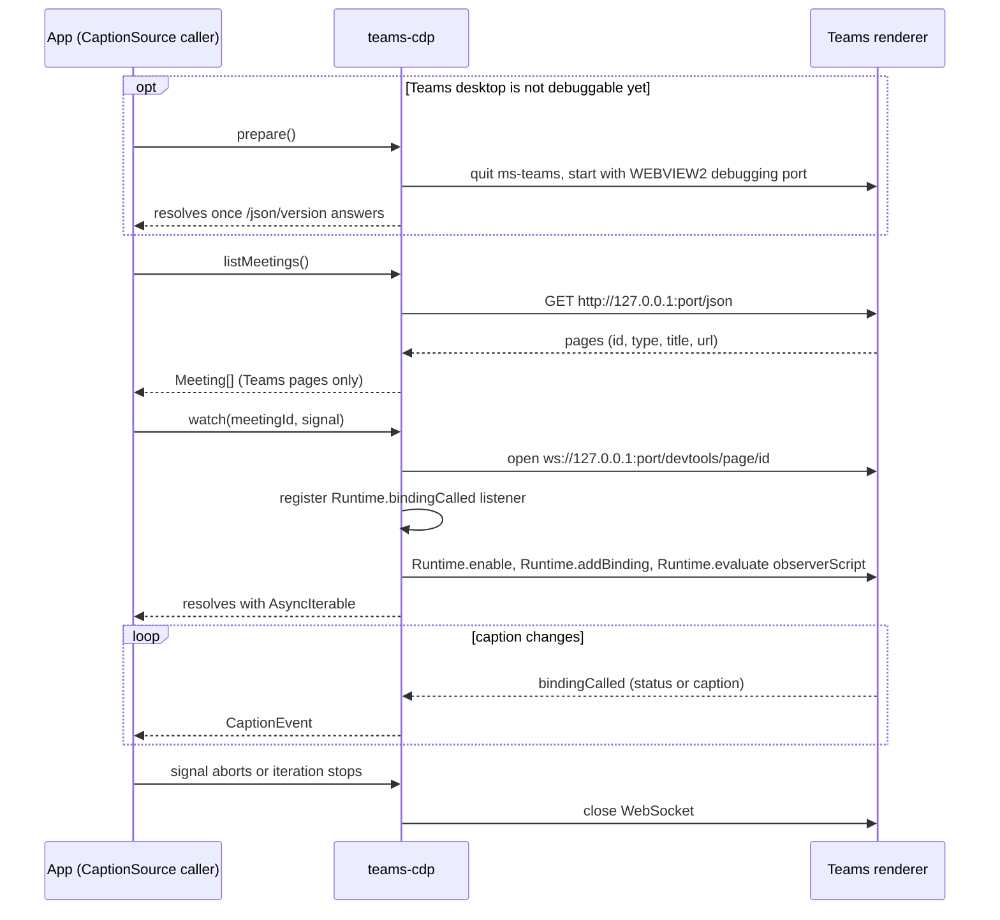

# @app/teams-cdp

An **interim** `CaptionSource` (the port in `@app/contracts`) that reads Teams live captions through the
Chrome DevTools Protocol (CDP). It attaches to the Teams renderer, injects a small observer into the page and
turns what the observer sees into `CaptionEvent`s. It relies on Teams' markup, not on a supported API, so
expect to replace it with an official SDK adapter later. The feature in `packages/features` does not change
when you do.

```ts
import { teamsCdp } from "@app/teams-cdp";

const source = teamsCdp(); // or teamsCdp({ port: 9333 }); the default is TEAMS_CDP_PORT, then 9222
```

The package must not import `@app/features`, `@app/components`, React or a web framework (oxlint enforces this).

## Architecture



Everything stays on `127.0.0.1`; callers never choose a host, and the port is fixed when the source is created.

## Sequence



The listener is registered before the observer is injected, because the observer reports the captions already
on screen as soon as it starts.

## How a caption is read

The observer (`src/observer-script.ts`) runs inside the Teams page:

1. It finds `[data-tid="closed-caption-text"]` elements. The line around each is `.fui-ChatMessageCompact`,
   `.fui-ChatMessage` or `.ui-chat__item`.
2. The speaker name comes from `[data-tid="author"]` in the same line. The speaker id (`Caption.speakerId`) comes from
   the line's avatar URL (`.../profilepicturev2/8:orgid:<object id>?displayname=...`); it is an empty string when a line has no avatar.
3. Each line gets an id (`<run>-<n>`, `<run>` random per injection) when first seen. Teams rewrites a line in
   place while speech is recognised, so the id stays and only `text` changes.
4. A line is reported only when its text differs from the last report. The observer reacts to DOM mutations and
   also scans once a second as a fallback.
5. It reports `status` when the caption panel appears or disappears.

Watching a page again stops the earlier observer first (`window.__boardroomObserver.stop()`), because the
earlier connection's binding no longer exists.

### Page-to-package messages

The observer sends JSON strings through `window.__boardroomCaption(...)`:

```ts
type PageMessage =
  | { type: "status"; captionsVisible: boolean }
  | { type: "caption"; caption: Caption };
```

These map one to one onto `CaptionEvent`.

## Files

| File                     | Role                                                                         |
| ------------------------ | ---------------------------------------------------------------------------- |
| `src/index.ts`           | `teamsCdp(options)`: builds the `CaptionSource`.                             |
| `src/list-meetings.ts`   | Lists pages on Teams domains from the DevTools `/json` endpoint.             |
| `src/watch-meeting.ts`   | Attaches, injects the observer and exposes the events as an `AsyncIterable`. |
| `src/cdp.ts`             | Minimal CDP client over the runtime's global `WebSocket` (Node 22+).         |
| `src/observer-script.ts` | The script injected into the Teams page.                                     |
| `src/launch-teams.ts`    | `prepare`: restarts new Teams on Windows with WebView2 remote debugging.     |

## Meeting ids

`Meeting.id` is the Teams meeting thread id (`19:meeting_…@thread.v2`), so meetings are told apart by a stable id
instead of a DevTools page id, which changes whenever a window opens or closes. Teams does not put it in the
page, so `list-meetings.ts` reads it from Teams' own IndexedDB: the `conversations` store of
`Teams:conversation-manager:*` has one record per conversation, and a meeting's `threadProperties.topic` is the
window title. Titles look like `<topic> | <org> | <account> | Microsoft Teams`, so each prefix of the title is
tried as the topic. If several threads share a topic, the one with the latest message wins. Pages that match no
meeting (the main client, chats) are not listed. A recurring meeting keeps one thread id across occurrences.

## Docked and popped-out captions

Popping the captions out of the meeting window opens a second Teams page with the same title, and that page
holds the caption elements. `listMeetings()` therefore lists one meeting per thread id, and `watch()` observes
every page of that meeting: the one you chose, any sibling found at start, and any that appears later (a
3-second poll), so popping out or back in during a call works. Lines from all pages share one stream, and
`captionsVisible` is true while any page shows the captions. The stream ends when the last page closes.

## Getting Teams ready to be read

- **Teams desktop (new Teams, Windows):** call `prepare()` (the **Restart Teams** button). It runs
  `Get-Process ms-teams | Stop-Process`, then starts `ms-teams.exe` with
  `WEBVIEW2_ADDITIONAL_BROWSER_ARGUMENTS=--remote-debugging-port=<port>` and waits up to 60 seconds. This ends
  any meeting in progress.
- **Browser:** start Chrome or Edge with `--remote-debugging-port=<port> --user-data-dir=<separate profile>`,
  join the meeting in it and turn on live captions.

## Limits

- The selectors are Teams implementation details. If Teams changes its markup, update `observer-script.ts`.
- Only captions Teams renders are visible, so live captions must be on in the meeting.
- Captions are streamed and not stored.
